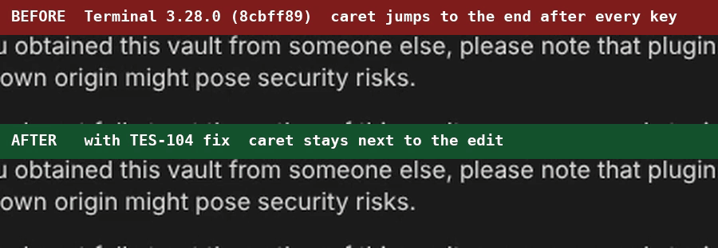
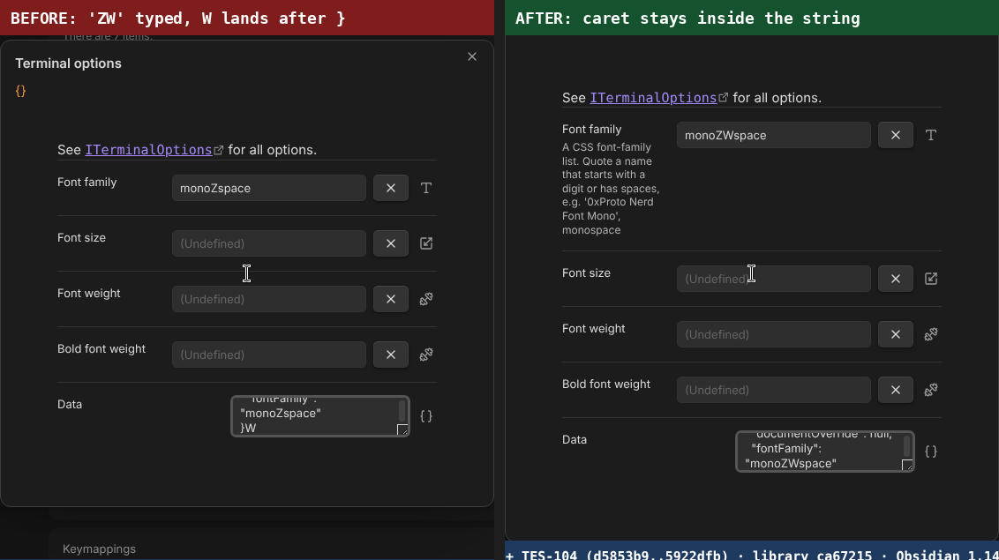
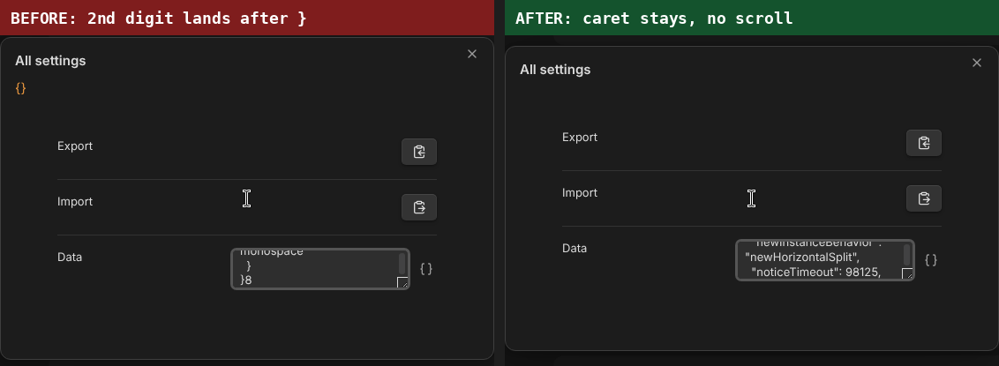
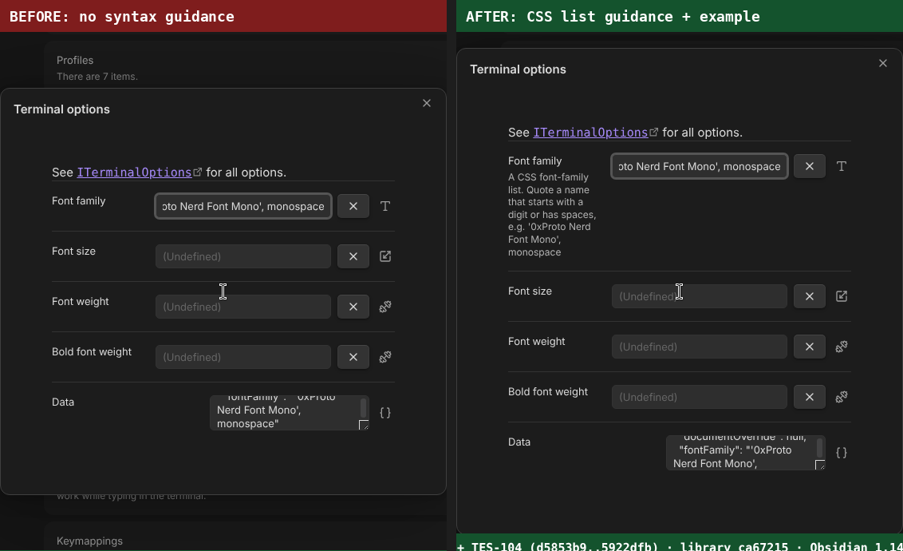

# TES-104 evidence: caret jumps to the end in settings fields

Evidence for the fix on branch
`ysrjanah/tes-104-settings-and-profile-editors-move-the-caret-to-the-end-while`
(plugin) and `ysrjanah/tes-104-preserve-caret-on-settings-refresh` (library).
This branch holds evidence only and is not meant to be merged.

## Environment

- Obsidian 1.14.4 (Linux AppImage), dark theme, fresh vault for every run
- BEFORE: Terminal 3.28.0 at `8cbff89`, library `b6eb90c`
- AFTER: the PR head, library `6691d16`. A rebuild from the final commits gives
  the same `main.js` SHA-256 (`d249f46060b618fb…`) as the build recorded here.
- Input: real key events sent through the Chrome DevTools Protocol
  (`Input.dispatchKeyEvent`), one key at a time; paste uses the system
  clipboard and Ctrl+V. The blue/green/red bar at the bottom of the screen is
  a caption added by the harness, not part of the plugin.

## The recorded scenario

Profile editor, Integrated profile, **Python executable** holding `python3`,
caret before `p`, type `uvx ` (the 2026-10-10 recording on the ticket):

| key | BEFORE | AFTER |
|---|---|---|
| `u` | `upython3`, caret 8 | `upython3`, caret 1 |
| `v` | `upython3v`, caret 9 | `uvpython3`, caret 2 |
| `x` | `upython3vx`, caret 10 | `uvxpython3`, caret 3 |
| space | `upython3vx `, caret 11 | `uvx python3`, caret 4 |

## Every text field, BEFORE and AFTER

Full screen recordings of the same scripted sweep:
[`tes-104-sweep-before.mp4`](tes-104-sweep-before.mp4) and
[`tes-104-sweep-after.mp4`](tes-104-sweep-after.mp4).
Raw results: [`results/before.json`](results/before.json),
[`results/after.json`](results/after.json).

| # | Field | Action | Expected | BEFORE (3.28.0) | AFTER (fix) |
|---|---|---|---|---|---|
| S1 | Settings ▸ Notice timeout (s) | caret at start, type 12 | `125` caret 2 | ❌ `152` caret n/a | ✅ `125` caret n/a |
| S2 | Settings ▸ Error notice timeout (s) | caret at start, type 12 | `120` caret 2 | ❌ `102` caret n/a | ✅ `120` caret n/a |
| T1 | Terminal options ▸ Font family | value monospace, caret after 'mono', type XY | `monoXYspace` caret 6 | ❌ `monoXspaceY` caret 11 | ✅ `monoXYspace` caret 6 |
| T2 | Terminal options ▸ Font size (number) | value 14, caret after '1', type 23 | `1234` caret 3 | ❌ `1243` caret n/a | ✅ `1234` caret n/a |
| T3 | Terminal options ▸ Font weight | value 400, caret after '4', type 12 | `41200` caret 3 | ❌ `41002` caret 5 | ✅ `41200` caret 3 |
| T4 | Terminal options ▸ Bold font weight | value 700, caret after '7', type 12 | `71200` caret 3 | ❌ `71002` caret 5 | ✅ `71200` caret 3 |
| T5 | Terminal options ▸ Data (raw JSON) | caret inside the fontFamily string, 4 chars in, type ZW (stays valid JSON) | `…mily": "monoZWspace"⏎}…` caret 53 | ❌ `…mily": "monoZspace"⏎}W…` caret 61 | ✅ `…mily": "monoZWspace"⏎}…` caret 53 |
| T7 | Terminal options ▸ Font family | dedicated field reflects raw JSON edit | `monoZWspace` | ❌ `monoZspace` | ✅ `monoZWspace` |
| T6 | Terminal options ▸ Data (raw JSON) | type " (invalid JSON), then Backspace (valid again) | `…Family": "monospace"⏎}…` caret 51 | ❌ `…Family": "monospace"⏎}…` caret 59 | ✅ `…Family": "monospace"⏎}…` caret 51 |
| T8 | Terminal options ▸ Font family ⇄ Data | type '0xProto Nerd Font Mono', monospace in field; JSON keeps it verbatim | `"fontFamily": "'0xProto Nerd Fo…` | ✅ `"fontFamily": "'0xProto Nerd Fo…` | ✅ `"fontFamily": "'0xProto Nerd Fo…` |
| A2 | All settings ▸ Data (raw JSON, scrolled) | caret before the noticeTimeout digits, type 9 then 8 (each keystroke valid) | `…ceTimeout": 98125,⏎  "openCh…` caret 2944 | ❌ `…ceTimeout": 9152,⏎  "openCha…` caret 6707 scroll 2681→6127 | ✅ `…ceTimeout": 98125,⏎  "openCh…` caret 2944 scroll 2681→2681 |
| A1 | All settings ▸ Data (raw JSON, scrolled) | caret mid-document after the key name, type _x then Backspace×2 (valid again) | `…gelogOnUpdate": true,⏎  "pin…` caret 2971 | ❌ `…gelogOnUpdate": true,⏎  "pin…` caret 6704 scroll 2732→6127 | ✅ `…gelogOnUpdate": true,⏎  "pin…` caret 2971 scroll 2732→2732 |
| P1 | Profile ▸ Name | value Linux, caret at start, type 'My ' | `My Linux` caret 3 | ❌ `MLinuxy ` caret 8 | ✅ `My Linux` caret 3 |
| P2 | Profile ▸ Executable | value /bin/sh, caret at start, type /usr | `/usr/bin/sh` caret 4 | ❌ `//bin/shusr` caret 11 | ✅ `/usr/bin/sh` caret 4 |
| P3 | Profile ▸ Python executable | value python3, caret before 'p', type 'uvx ' (the recorded scenario) | `uvx python3` caret 4 | ❌ `upython3vx ` caret 11 | ✅ `uvx python3` caret 4 |
| P4 | Profile ▸ Python executable | caret after 'uvx ', Backspace then type ' ' (delete mid-value) | `uvx python3` caret 4 | ❌ `upyhon3vx  ` caret 11 | ✅ `uvx python3` caret 4 |
| P5 | Profile ▸ Python executable | caret after 'uvx ', paste ~/.venv/bin/ with Ctrl+V | `uvx ~/.venv/bin/python3` caret 16 | ❌ `upyh~/.venv/bin/on3vx  ` caret 23 | ✅ `uvx ~/.venv/bin/python3` caret 16 |
| P6 | Profile ▸ Python executable | select '~/.venv/bin/' (Shift+→×12) and type /opt/ to replace it | `uvx /opt/python3` caret 9 | ❌ `upyh/on3vx  opt/` caret 16 | ✅ `uvx /opt/python3` caret 9 |
| P7 | Profile ▸ Data (raw JSON) | caret at the start of the executable string, type /opt (stays valid JSON) | `…utable": "/opt/usr/bin/sh",⏎…` caret 58 | ❌ `…utable": "///bin/shusr",⏎  "…` caret 436 | ✅ `…utable": "/opt/usr/bin/sh",⏎…` caret 58 |
| P8 | Profile ▸ Terminal options ▸ Font family | value mono, caret at start, type ui- | `ui-mono` caret 3 | ❌ `umonoi-` caret 7 | ✅ `ui-mono` caret 3 |
| P9 | Profile ▸ Success exit codes ▸ 1st | value 0, caret at start, type 13 | `130` caret 2 | ❌ `103` caret 3 | ✅ `130` caret 2 |
| P10 | Profile ▸ Arguments ▸ 1st | value --login, caret after '--', type no- | `--no-login` caret 5 | ❌ `--nlogino-` caret 10 | ✅ `--no-login` caret 5 |
| P11 | Profile ▸ Environment variables ▸ key | key PATH, caret at start, type MY_ | `MY_PATH` caret 3 | ❌ `MPATHY_` caret 7 | ✅ `MY_PATH` caret 3 |
| P12 | Profile ▸ Environment variables ▸ value | value /bin, caret at start, type /usr | `/usr/bin` caret 4 | ❌ `//binusr` caret 8 | ✅ `/usr/bin` caret 4 |
| K1 | Keymappings ▸ PageUp ▸ argument | number arg -1, caret after '-', type 20 | `-201` caret 3 | ❌ `-210` caret n/a | ✅ `-201` caret n/a |
| K2 | Keymappings ▸ Shift+Enter ▸ argument | string arg, caret at start, type ab | `ab⏎` caret 2 | ❌ `a⏎b` caret 3 | ✅ `ab⏎` caret 2 |

**BEFORE 1/26 · AFTER 26/26.** T8 checks the nested-quote round trip, which already worked; every caret check fails before the fix.

Expected values are for the AFTER run. Once a BEFORE step garbles a field, later BEFORE steps on that field start from the garbled text; each is judged against its own expected value in `results.json`. `caret n/a` marks `type=number` inputs, which have no selection API; they are judged by where the next digit lands.

## Raw JSON editors

## Font family guidance

## Test runs

- [`test-runs/library-tests-before-fix.txt`](test-runs/library-tests-before-fix.txt):
  the new regression tests with the fix's guard removed; both caret tests fail
  (`[8, 8]` instead of `[1, 1]`, `[32, 32]` instead of `[24, 24]`).
- [`test-runs/library-tests-after-fix.txt`](test-runs/library-tests-after-fix.txt):
  the same tests with the fix.
- [`test-runs/library-full-suite.txt`](test-runs/library-full-suite.txt):
  library, 990 passed.
- [`test-runs/plugin-vitest.txt`](test-runs/plugin-vitest.txt): plugin Vitest,
  1280 passed, 5 skipped.
- [`test-runs/plugin-pytest.txt`](test-runs/plugin-pytest.txt): plugin pytest,
  240 passed, 78 skipped (Windows-only).

## Reproducing

[`harness/`](harness) holds the scripts: `launch.sh` starts Obsidian on Xvfb
with a fresh vault and a plugin build, `record.sh` records the screen while
`sweep.mjs` drives every field, and `scenario.mjs` replays the recorded
Python executable scenario. They need Xvfb, ffmpeg, Node and
`playwright-core`; paths at the top of each script point at the session's
scratch directory.
